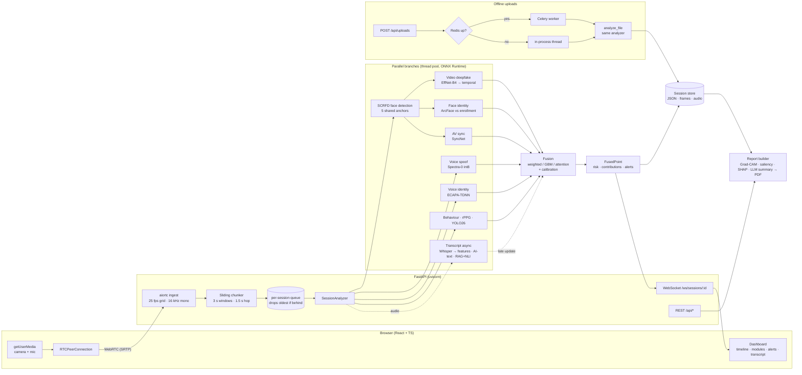

# Architecture



## Key design decisions

| Decision | Why |
|---|---|
| **Every module emits `{score, confidence, t_start, t_end, details}`** | Uniform fusion input; confidence 0 = "no evidence" (no face, no speech), so missing modalities are first-class instead of imputed. |
| **Shared face detections** (5 anchor frames / window) | SCRFD is the most-shared cost; video, identity and SyncNet reuse it (SyncNet interpolates boxes between anchors). |
| **ONNX Runtime everywhere for inference**, providers TensorRT → CUDA → DirectML → CPU | One code path for laptop and GPU box; parity-checked exports; `set_denormal_as_zero` (measured 40× CPU speed-up). |
| **Per-session thread caps** (3 intra-op threads) | Branches run concurrently; uncapped sessions oversubscribed the CPU (9.5 s → 1.7 s per window). |
| **Staggered CPU schedule** | With 50 % overlap, running a module on every other window still tiles the timeline contiguously; heavy modules alternate even/odd windows. GPU profile runs everything every window. |
| **Asynchronous transcript branch** | ASR is slower than the hop on CPU; answers are analysed when an utterance ends (VAD) and *retroactively update* the overlapping timeline points. |
| **Fusion = confidence-weighted mean log-odds + red-flag term** (prior), learned GBM / attention when labelled data exists | Avoids naive-Bayes overconfidence from correlated "looks genuine" modules while letting one strong signal (e.g. face mismatch) dominate. |
| **Calibration** (temperature for logit models, isotonic for GBM) fit on held-out participants | Risk values are meant to be read by people; ECE is reported. |
| **Explanations computed on demand** | Grad-CAM (PyTorch) and occlusion saliency only for flagged evidence when a report is requested, keeping the live path ONNX-only. |

## Code map

```
src/trusthire/
  common/      types, settings, registry (weights), ORT factory, face (SCRFD+ArcFace), media, augment, export
  video/       model (EffNet-B4/Xception/timm + temporal heads), infer, prepare, train, eval
  audio/       model (AASIST/RawNet2/SSL/Spectra-0), infer (+int8), datasets, train, eval
  avsync/      SyncNet towers, infer, eval (desync study)
  identity/    ArcFace + ECAPA monitors, speaker encoder, eval (LFW / LibriSpeech)
  behavior/    MediaPipe gaze/pose/blinks, reading sweeps, rPPG (POS/CHROM), YOLO26
  transcript/  faster-whisper ASR, features, AI-text + RAG/NLI, async monitor, train
  fusion/      features, models (weighted / GBM / attention + calibration), live fuser
  explain/     Grad-CAM, audio saliency, plots, LLM providers, PDF report
  pipeline/    chunker, analyzer, offline runner, session store
  api/         FastAPI app, WebRTC ingest
  worker/      Celery app, job runner (with in-process fallback)
  evaluation/  metrics, dataset schema, harness (ablations/fairness), latency, synthetic (tests only), report
  third_party/ vendored AASIST (MIT), SyncNet (MIT), DeepfakeBench Xception (CC BY-NC)
```
